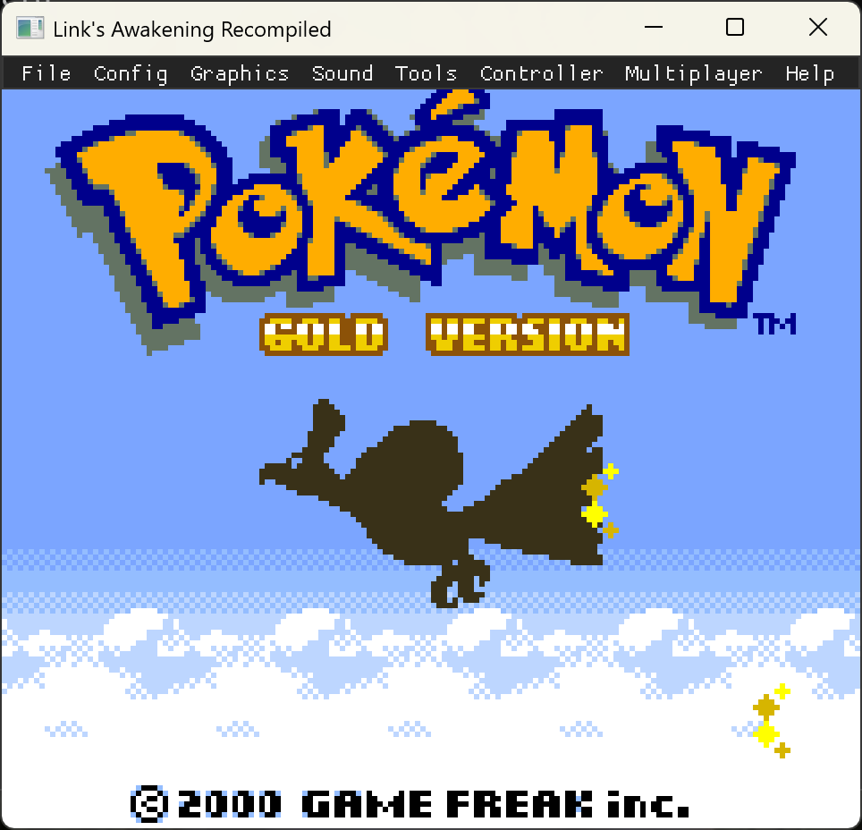
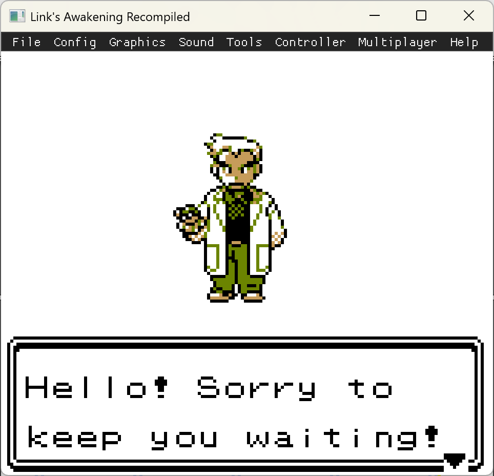
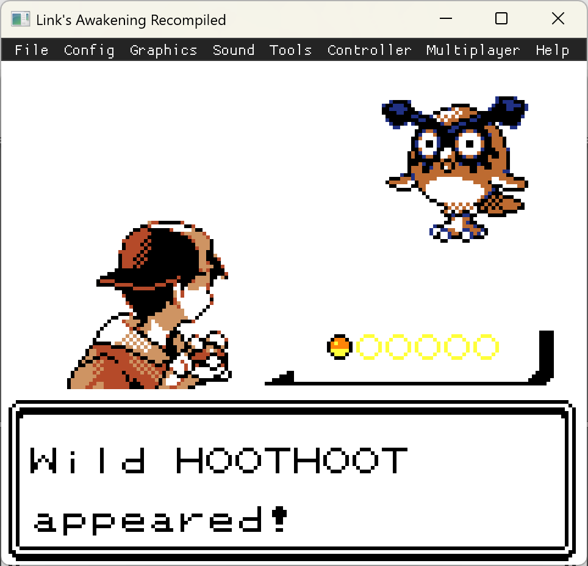
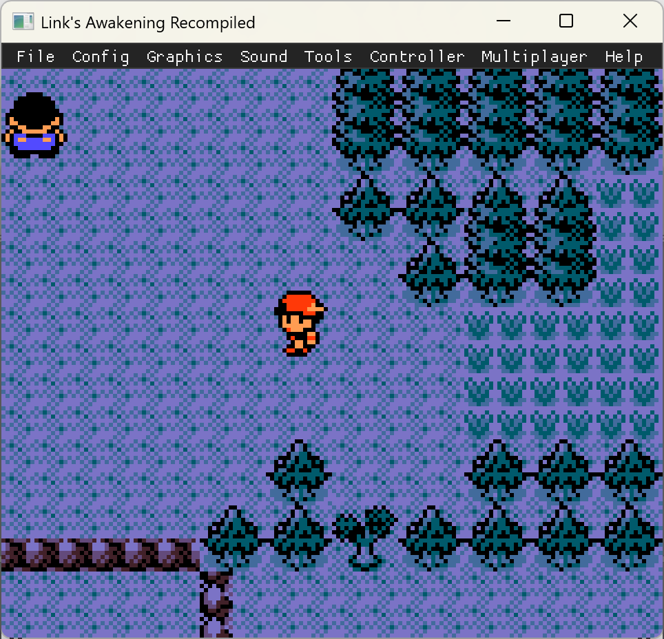

# Pokémon Gold — Statically Recompiled

> *Pokémon Gold, but it's a native executable. No emulator. No ROM interpretation at runtime. Just ~~Game Boy~~ Color machine code translated, ahead of time, into portable C.*

This repository ports **Pokémon Gold Version (Game Boy Color, 1999)** to native code via [**gb-recompiled**](https://github.com/sp00nznet/gb-recompiled) — a static recompiler that lifts SM83 (Z80-ish) assembly directly into C. The result builds and runs at full CPU speed on Windows, Linux, and macOS, with no emulator in the loop.

Gold is the **first Generation II Pokémon title** attempted with this toolchain. Gen 2 introduces an **MBC3 mapper with a real-time clock** — the chip that drives the day/night cycle, weekly events, and Apricorn/berry timers. The mapper and RTC registers were already in [our fork](https://github.com/sp00nznet/gb-recompiled); RTC save persistence (BGB-compatible 48-byte `.rtc` sidecar with wall-clock advancement) landed [upstream](https://github.com/sp00nznet/gb-recompiled/commits/main) as part of this port.

|  |  |
|---|---|
|  |  |
| Boots straight to the title screen. | "Hello! Sorry to keep you waiting." — and he isn't. |
|  |  |
| First wild encounter — Hoothoot, as Gen 2 demands. | Overworld; CGB palettes, sprites, scrolling all behaving. |

---

## ⚠️ Status: Bring-up in progress

| Milestone | Status |
| --- | :---: |
| Repo scaffolding (CMake, submodule, entry point) | ✅ |
| `gb-recompiled` toolchain builds locally (MSVC + vcpkg SDL2) | ✅ |
| First successful recompile (`gbrecomp` → 58 MB `rom.c` + 13 MB `rom_rom.c`) | ✅ |
| `rom.exe` links cleanly under MSVC + vcpkg SDL2 | ✅ |
| Runtime boots, identifies cart `POKEMON_GLDAAUE`, allocates 32 KB MBC3 RAM | ✅ |
| First boot to title screen (visually confirmed) | ✅ |
| New game → intro plays → Prof. Elm dialogue | ✅ |
| Wild encounter renders (Hoothoot, full sprite + palette) | ✅ |
| Overworld walks, scrolls, NPCs render | ✅ |
| **RTC persistence** (48-byte `.rtc` sidecar, wall-clock advance on load) | ✅ |
| MSVC-portable generated code (upstream `c_emitter` shim) | ✅ |
| Trace-guided recompile (`run_ground_truth.py`) to retire the 91 demoted functions | ⏳ |
| Day/night cycle observably working (in-game time passes correctly) | ⏳ |
| Save & load round-trips a full party + box | ⏳ |
| Audio: investigate stutter when window loses focus | ⏳ |
| Compatibility row on `gb-recompiled/COMPATIBILITY.md` flipped to ✓ | ⏳ |

Updated on each push — check the [commits](../../commits/main) for the play-by-play.

---

## How it works

```
┌─────────────────────────┐    ┌──────────────────────┐    ┌────────────────────┐
│ Pokemon Gold.gbc        │    │ gbrecomp recompiler  │    │ rom.c (~115 MB) +  │
│ (your legal copy)       │ ─► │ + execution trace    │ ─► │ rom_rom.c          │
│ 2 MB Z80 machine code   │    │ (ground-truth seed)  │    │ portable C source  │
└─────────────────────────┘    └──────────────────────┘    └─────────┬──────────┘
                                                                     │ cmake/ninja
                                                                     ▼
                          ┌──────────────────────────────────────────────────────┐
                          │ rom.exe                                              │
                          │ ├─ Translated game code (no interpreter for the      │
                          │ │  ~99% of code paths the recompiler proved)         │
                          │ ├─ gbrt runtime (PPU, APU, MBC3+RTC, save/load)      │
                          │ └─ SDL2 platform layer + Dear ImGui debug overlay    │
                          └──────────────────────────────────────────────────────┘
```

A small fallback interpreter handles indirect jumps the static analyser couldn't resolve. Every other instruction in the ROM becomes a native function call — the CPU you're running on executes Gold's code, not a Z80 simulation of it.

---

## Building

> Bring your own ROM — none ship here, none ever will. Place a legally obtained **Pokemon - Gold Version (UE) \[C\]\[!\].gbc** (or another Gold revision) into `roms/`.

### Prerequisites

- **Windows**: Either path works.
  - **MSVC**: Visual Studio 2022 Build Tools (the C++ workload), CMake ≥ 3.16, Ninja, and SDL2 via [vcpkg](https://github.com/microsoft/vcpkg) (`vcpkg install sdl2:x64-windows`). Configure with `-DCMAKE_TOOLCHAIN_FILE=<vcpkg>/scripts/buildsystems/vcpkg.cmake -DVCPKG_TARGET_TRIPLET=x64-windows`. **This is what the current build is verified against.**
  - **MinGW**: [MSYS2](https://www.msys2.org/) with the MinGW64 toolchain — `pacman -S mingw-w64-x86_64-{cmake,ninja,clang,SDL2}`. Used by the sibling LinksAwakening project.
- **macOS / Linux**: `cmake`, `ninja`, `clang` or `gcc`, `SDL2` dev headers
- **Python 3** (for the trace-capture script)

### Clone

```bash
git clone --recurse-submodules https://github.com/sp00nznet/pokemon-gold.git
cd pokemon-gold
```

### Build the gb-recompiled toolchain

```bash
cd gbrecomp
./tools/setup.sh           # macOS/Linux
# or
./tools/setup.ps1          # Windows PowerShell
cd ..
```

### Recompile your ROM

The trace-guided workflow gives the recompiler dynamic execution evidence for every code path the title screen + new-game intro touches:

```bash
python3 gbrecomp/tools/run_ground_truth.py roms/pokegold.gbc
./gbrecomp/build/bin/gbrecomp roms/pokegold.gbc -o . --use-trace pokegold.trace
```

This generates `rom.c` and `rom_rom.c` directly into the project root (both gitignored).

### Build the executable

```bash
cmake -G Ninja -S . -B build
ninja -C build
./build/rom
```

---

## What's hard about Gen 2 specifically

Gold is meaningfully more involved than Link's Awakening or Gen 1 Pokémon:

- **MBC3 + RTC** — the real-time clock advances even with the game off, persisting day/night state, Bug-Catching Contest schedule, weekly events (Lapras on Fridays, Bug Contest on T/Th/Sa…), and timed berry/Apricorn growth. The fork latches/reads/writes the RTC registers, and **now persists them** via a BGB-compatible 48-byte `.rtc` sidecar alongside the `.sav`. On load, the runtime advances the registers by the wall-clock interval since the last save — same behaviour as a real cart's onboard oscillator running while the system is off.
- **2 MB ROM, 8 KB cart RAM** — twice Link's Awakening's footprint. Generated C grows proportionally.
- **CGB-mandatory** — Gold *only* boots in Color mode, so the runtime's CGB paths (palette RAM, VRAM banking, HDMA) get exercised hard.
- **Time-of-day palette swaps** — happen on a 4-period schedule driven by the RTC, not the in-game clock. Catches bugs the LA palette test never would.

---

## Debug toys

Inherited from the `gb-recompiled` runtime:

| Flag | Effect |
| --- | --- |
| `--trace` | dump every translated instruction address that executes |
| `--trace-entries FILE` | save the trace to disk (use as `--use-trace` seed on a re-recompile) |
| `--limit N` | cap total instructions (handy for crash bisection) |
| `--input FILE` | replay a recorded input script |
| `--dump-frames DIR` | write every frame as a PNG (regression diff!) |
| `--screenshot-prefix P` | F12 dumps frames to `P-NNNN.png` |
| `--hw-trace FILE` | log PPU/APU register writes |
| `--frames N` | exit after N frames |

The runtime also embeds Dear ImGui with palette/VRAM/OAM/asset viewers — toggle via `F1`.

---

## Roadmap

1. ~~**Boot** to the title screen.~~ Done.
2. ~~**Intro** dialogue, Prof. Elm's lab.~~ Done.
3. ~~**RTC persistence** in our `gb-recompiled` fork.~~ Done — landed in upstream commits `0cd971d` / `b37275d` / `fda073e`.
4. **Starter selection**: walk to Mr. Pokémon, get the Mystery Egg, return.
5. **Trace-guided recompile**: run `tools/run_ground_truth.py` against Gold to retire the 91 interpreter-demoted functions and tighten coverage on the long-tail code paths.
6. **Time-of-day visuals**: confirm palette swaps at 06:00 / 10:00 / 18:00 / 22:00 game time, with the RTC actually advancing across relaunches.
7. **Save round-trip**: PC box / party / RTC all survive a quit + relaunch.
8. **Audio polish**: the user reports stutter when the window loses focus — likely a callback-pacing issue in the SDL audio loop. Worth investigating once gameplay is fully stable.
9. **Long-play stress test**: run for a full in-game day at 4× speed, check for desyncs.
10. **Crystal/Silver**: once Gold is stable, the same recipe should drop in.

Possible (much later) stretch goals:

- 🔗 Bring the existing la-mp multiplayer overlay to Gold for **online link-cable trades and battles** — Gen 2 cable code is well-documented thanks to [pret/pokegold](https://github.com/pret/pokegold).
- 🌐 Port to PS3/PS4/3DS via the [linksawakening-portable](https://github.com/sp00nznet/linksawakening-portable) pattern.

---

## Legal

This repository contains **zero** copyrighted Nintendo material. The generated `rom.c` / `rom_rom.c` files are derivatives of *your* ROM dump, never committed, never distributed. Repository code is MIT; the game is and remains the property of Nintendo / Game Freak / The Pokémon Company.

> *Pokémon and Game Boy are trademarks of Nintendo. Bring your own legally obtained ROM. We don't ship one. We never will.*

---

## Credits & Acknowledgements

- **Nintendo / Game Freak / Creatures Inc.** — for *Pokémon Gold* (1999/2000). All in-game assets remain their intellectual property.
- **[arcanite24](https://github.com/arcanite24)** — original author of [gb-recompiled](https://github.com/arcanite24/gb-recompiled), the static recompiler this whole project pivots around.
- **[sp00nznet/gb-recompiled](https://github.com/sp00nznet/gb-recompiled)** — our fork, where Gen 2 / MBC3-RTC fixes land. Upstream improvements from this Gold port flow back here, **not** to arcanite24's repo.
- **[pret](https://github.com/pret) / [pokegold disassembly](https://github.com/pret/pokegold)** — the symbolicated assembly listing that makes every "what does this opcode at $4:5BAC do?" question answerable. Indispensable for triage.
- **[LIJI32](https://github.com/LIJI32) & contributors** — *SameBoy*, the highest-accuracy GB/GBC emulator and the reference implementation for tricky timing edge-cases (especially the MBC3 RTC latch sequence and CGB STAT-blocking quirks).
- **[ocornut](https://github.com/ocornut)** — [Dear ImGui](https://github.com/ocornut/imgui), powering the runtime's debug overlays.
- **[lsalzman](https://github.com/lsalzman)** — [ENet](https://github.com/lsalzman/enet), the UDP networking layer the (currently unused on Gold) multiplayer overlay rides on.
- **[libsdl-org](https://github.com/libsdl-org)** — SDL2 for window/audio/input.
- **Prior art** — [sp00nznet/LinksAwakening](https://github.com/sp00nznet/LinksAwakening) (the first game completed with this stack) and [sp00nznet/linksawakening-portable](https://github.com/sp00nznet/linksawakening-portable) (PS3/PS4/3DS port pattern) — both serve as the working template here.

If your work is here and the credit is wrong or missing, open an issue — happy to fix it.
